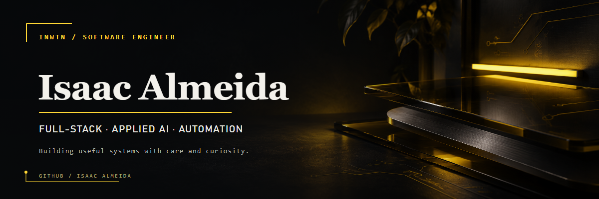

<p align="center">
  
</p>

<p align="center">
  <a href="https://www.linkedin.com/in/isaacalmeida-dev">LinkedIn</a> ·
  <a href="https://github.com/Inwtn">GitHub</a> ·
  <a href="mailto:isaacreis.dev@gmail.com">Email</a>
</p>

<p align="center">
  <code>GRAFITE #080B0D</code> &nbsp; <code>PAINEL #0F1214</code> &nbsp; <code>NEON #FFD735</code>
</p>

---

## Isaac Almeida

### Construo software para tirar trabalho repetitivo do caminho.

Engenheiro de Software na **3D Lab**, trabalhando em módulos internos de ERP, integrações e automações. Minha experiência anterior em operações financeiras me ajuda a entender os processos por trás dos sistemas — de fluxo de caixa e conciliação a contas a pagar e receber.

```text
FINANÇAS  ── automação ──>  SOFTWARE  ── integrações ──>  MENOS TAREFA MANUAL
```

**Hoje:** JavaScript · PHP · Laravel · Python · APIs · ERP  
**Experiência de produção:** Java · Spring Boot · microsserviços  
**Explorando:** IA generativa · LLMs · RAG · cibersegurança

---

## Projetos em destaque

### 01 · Bank Reconciliation Engine
**Conciliação financeira com menos conferência manual.** Importa extratos OFX/CSV, cruza lançamentos e classifica cada transação como conciliada, divergente ou pendente.

[Ver repositório](https://github.com/Inwtn/bank-reconciliation)

### 02 · StreamHub
**Compartilhamento de tela direto entre pessoas.** Salas privadas com WebRTC, chamadas de voz opcionais e diagnóstico de conexão.

[Ver código](https://github.com/Inwtn/streamhub) · [Abrir demonstração](https://streamhub-inwtn.onrender.com)

### 03 · Lupa.NET
**Exploração local de assemblies .NET.** Inspeciona código C# reconstruído, IL, metadados, referências e strings sem executar o assembly analisado.

[Ver repositório](https://github.com/Inwtn/lupa-net)

### 04 · MNEME
**Pesquisa de mercado com ferramentas de dados e IA.** Projeto de pesquisa financeira com pipelines de dados, backtesting e fluxos locais de LLM/RAG.

[Ver projeto](https://github.com/Inwtn/MNEME) · [Abrir aplicação](https://mneme-1b8.pages.dev/)

---

## Minha trajetória

| Período | Foco |
| --- | --- |
| Set 2026 – atual | Software Engineer · ERP, integrações e IA aplicada · 3D Lab |
| Fev 2025 – Jun 2026 | Software Developer · Java, Spring Boot e automação |
| Out 2020 – Fev 2025 | Analista Financeiro · fluxo de caixa e conciliação |
| 2025 – atual | Análise e Desenvolvimento de Sistemas · Newton Paiva / Wyden |

Passei mais de quatro anos em operações financeiras antes de migrar para desenvolvimento. Foi automatizando planilhas e rotinas financeiras que comecei essa transição.

---

## Ferramentas que uso

`JavaScript` `PHP` `Laravel` `Python` `Java` `Spring Boot` `React` `MySQL` `PostgreSQL` `Git` `Linux` `REST APIs`

**IA e automação**  LLMs · RAG · agentes de IA · integração de APIs  
**Segurança em estudo**  Linux · SIEM/IDS · detecção de ameaças · resposta a incidentes

---

## Formação e idiomas

- **Análise e Desenvolvimento de Sistemas** · Newton Paiva / Wyden · 2025 – atual
- **Google Cybersecurity** · Google · 2026
- **Started with Cybersecurity** · IBM · 2026
- **Português** · nativo &nbsp; **Inglês** · B2, escrita B1

---

<p align="center">
  <b>Se envolve automação, APIs ou sistemas de negócio, vamos conversar.</b><br />
  <a href="mailto:isaacreis.dev@gmail.com">isaacreis.dev@gmail.com</a> ·
  <a href="https://www.linkedin.com/in/isaacalmeida-dev">LinkedIn</a>
</p>

<p align="center"><sub>Feito com curiosidade, lógica de negócio e um toque de amarelo neon.</sub></p>
