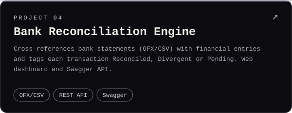
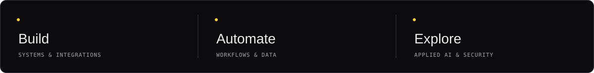

<a href="https://isaac-reis.vercel.app/">
  
</a>

<p align="center"><sub>A different perspective. The same curiosity.</sub></p>

<p align="center">
  <a href="https://isaac-reis.vercel.app/"></a>
  <a href="https://www.linkedin.com/in/isaacalmeida-dev"></a>
  <a href="mailto:isaacreis.dev@gmail.com"></a>
</p>


I'm **Isaac Almeida**, a software engineer in Brazil. I connect APIs, databases and real business workflows, turning repetitive work into reliable software. At **3D Lab**, I work on full-stack features for internal ERP modules with JavaScript, PHP, Laravel, Python and integrations.

Before software engineering, I spent over four years in financial operations. That experience taught me to understand the process behind the code, follow the details and build for the people using the system.

I'm exploring **Generative AI, LLMs and agents** in practical development workflows, while deepening my interest in **cybersecurity**. My [interactive portfolio](https://isaac-reis.vercel.app/#about) tells the longer story.

<p align="center"></p>


<p align="center">
  <a href="https://github.com/Inwtn/streamhub"></a>
  <a href="https://github.com/Inwtn/Lupa.NET"></a>
  <a href="https://github.com/Inwtn/MNEME"></a>
  <a href="https://github.com/Inwtn/bank-reconciliation"></a>
</p>

<p align="center"><a href="https://streamhub-inwtn.onrender.com">StreamHub live ↗</a> &nbsp;·&nbsp; <a href="https://isaac-reis.vercel.app/#work">Explore the portfolio case studies ↗</a></p>


| Area | Tools and interests |
| --- | --- |
| **Backend & integrations** | Java · Spring Boot · PHP · Laravel · Python · REST APIs |
| **Frontend** | JavaScript · React · HTML · CSS |
| **Data & workflow** | MySQL · PostgreSQL · Git · Linux · automation |
| **Applied AI** | LLMs · AI agents · RAG · prompt engineering |
| **Security** | SIEM/IDS · threat detection · incident response |


```text
2026 → now    Software Engineer · 3D Lab
              Full-stack ERP · APIs · automation · applied AI

2025 → 2026  Software Developer
              Java/Spring Boot · microservices · REST APIs

2020 → 2025  Financial Analyst · Benericks Cocktail Co
              Financial operations · reconciliation · process improvement

2025 → now   Systems Analysis and Development · Newton Paiva / Wyden
```

<details>
<summary>More about the path</summary>
<br />

At 3D Lab I architect, plan and implement full-stack features for internal ERP modules, maintain integrations and use AI-assisted workflows for scripts, testing and refinement. Earlier, I built Java and Spring Boot backend services and automated financial processes. My financial background continues to shape how I approach business rules and data quality.

</details>


| Certification | Focus |
| --- | --- |
| **Google Cybersecurity** · Google (2026) | Threats, vulnerability management, Linux, SQL, Python, SIEM/IDS and incident response |
| **Started with Cybersecurity** · IBM (2026) | Security foundations, encryption, malware and defense practices |
| **RAG with ChromaDB, LlamaIndex and Python** · Santander | LLM applications, orchestration and vector databases |
| **Data with Python and AI** · Santander | Data analysis, visualization and machine learning foundations |
| **Web Development Fundamentals** · IBM | Semantic HTML, responsive CSS, JavaScript and the DOM |

<p><sub>Languages: Portuguese (native) · English (B2; writing B1)</sub></p>





<picture>
  <source media="(prefers-color-scheme: dark)" srcset="https://raw.githubusercontent.com/Inwtn/Inwtn/output/github-snake-dark.svg" />
  <source media="(prefers-color-scheme: light)" srcset="https://raw.githubusercontent.com/Inwtn/Inwtn/output/github-snake.svg" />
  
</picture>

<p align="center"><sub>From the event horizon to the next useful system. <a href="https://isaac-reis.vercel.app/">Explore the portfolio ↗</a></sub></p>
