

  

  <a href="mailto:isaacreis.dev@gmail.com">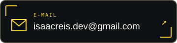</a>
  <a href="https://github.com/Inwtn">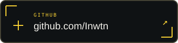</a>
  <a href="https://www.linkedin.com/in/isaacalmeida-dev">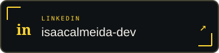</a>

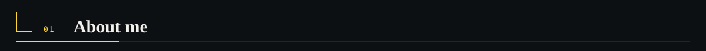

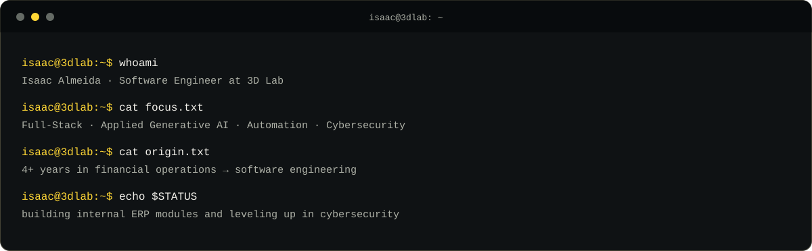

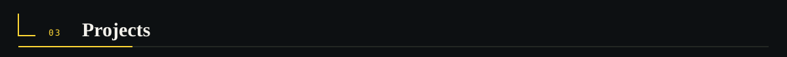

  <a href="https://github.com/Inwtn/bank-reconciliation">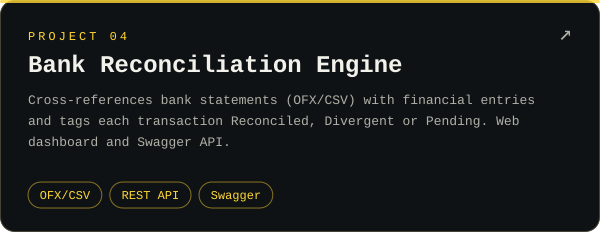</a>
  <a href="https://github.com/Inwtn/streamhub">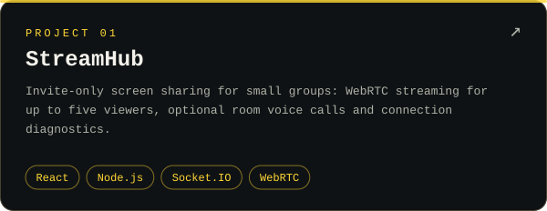</a>
  <a href="https://github.com/Inwtn/lupa-net">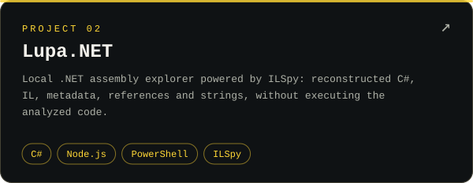</a>
  <a href="https://github.com/Inwtn/MNEME">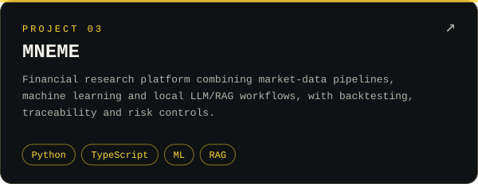</a>

<a href="https://streamhub-inwtn.onrender.com">OPEN STREAMHUB DEMO ↗</a> &nbsp;·&nbsp; <a href="https://mneme-1b8.pages.dev/">OPEN MNEME ↗</a>

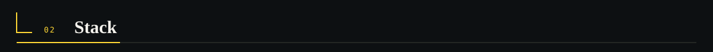

<b><code>BACKEND &amp; APIs</code></b>

<b><code>FRONTEND</code></b>

<b><code>DATA &amp; TOOLS</code></b>

<b><code>AI · AUTOMATION · SECURITY</code></b> 
  
  
  
  
  

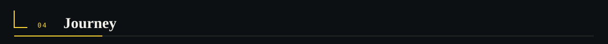

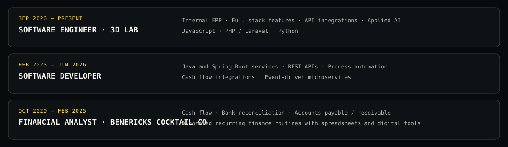

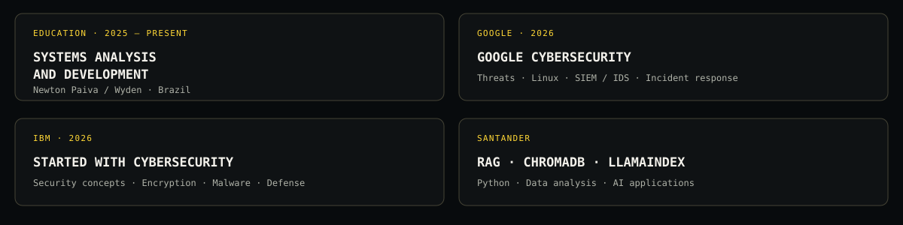

<code>PORTUGUESE</code> Native &nbsp;·&nbsp; <code>ENGLISH</code> B2 · Writing B1

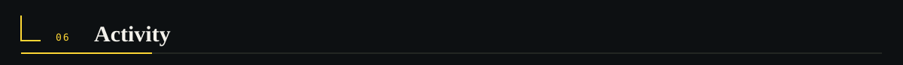

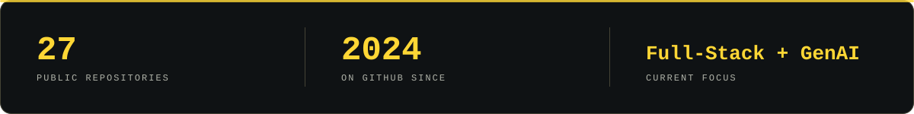

<picture>
  <source media="(prefers-color-scheme: dark)" srcset="https://raw.githubusercontent.com/Inwtn/Inwtn/output/github-snake-dark.svg" />
  <source media="(prefers-color-scheme: light)" srcset="https://raw.githubusercontent.com/Inwtn/Inwtn/output/github-snake.svg" />
  
</picture>
