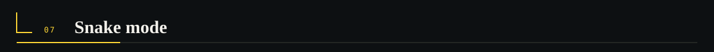

  

  <a href="mailto:isaacreis.dev@gmail.com">[ GET IN TOUCH ]</a> &nbsp;·&nbsp;
  <a href="https://github.com/Inwtn">[ GITHUB ]</a> &nbsp;·&nbsp;
  <a href="https://www.linkedin.com/in/isaacalmeida-dev">[ LINKEDIN ]</a>

  

<code>FOCUS</code> Automation + APIs &nbsp; <code>BASED AT</code> 3D Lab · ERP

## 01 / ABOUT

I build internal ERP features, integrations and automation with **JavaScript, PHP, Laravel and Python**. I have also built production services with **Java and Spring Boot**. My financial operations background helps me understand business rules before turning them into software.

Before moving into software engineering, I spent more than four years working in financial operations, including cash flow, bank reconciliation and accounts payable/receivable.

<code>BUSINESS OPERATIONS</code> &nbsp; <code>SOFTWARE ENGINEERING</code> &nbsp; <code>PROCESS AUTOMATION</code>

## 02 / TECHNICAL SKILLS

  

<code>REST APIs</code> &nbsp; <code>LLMs</code> &nbsp; <code>RAG</code> &nbsp; <code>AI AGENTS</code> &nbsp; <code>SIEM / IDS</code>

## 03 / FEATURED PROJECTS

| PROJECT | OVERVIEW | LINKS |
| --- | --- | --- |
| **Bank Reconciliation** · Java | Reconciles OFX/CSV bank statements with financial entries, flagging matched, divergent and pending transactions. | [SOURCE](https://github.com/Inwtn/bank-reconciliation) |
| **StreamHub** · WebRTC | Private rooms for peer-to-peer screen sharing, with optional voice calls and connection diagnostics. | [SOURCE](https://github.com/Inwtn/streamhub) · [LIVE DEMO](https://streamhub-inwtn.onrender.com) |
| **Lupa.NET** · .NET | Locally explores reconstructed C#, IL, metadata and references without executing the analyzed assembly. | [SOURCE](https://github.com/Inwtn/lupa-net) |
| **MNEME** · Python / AI | Financial research with market data pipelines, backtesting and local LLM/RAG workflows. | [SOURCE](https://github.com/Inwtn/MNEME) · [APP](https://mneme-1b8.pages.dev/) |

## 04 / EXPERIENCE

| PERIOD | ROLE | FOCUS |
| --- | --- | --- |
| **Sep 2026 – Present** | Software Engineer · 3D Lab | Internal ERP, full-stack features, integrations and applied AI |
| **Feb 2025 – Jun 2026** | Software Developer | Java, Spring Boot, microservices and financial process automation |
| **Oct 2020 – Feb 2025** | Financial Analyst · Benericks Cocktail Co | Cash flow, bank reconciliation and finance operations |

## 05 / EDUCATION & CERTIFICATIONS

- **Systems Analysis and Development** · Newton Paiva / Wyden · 2025 – Present
- **Google Cybersecurity** · Google · 2026
- **Started with Cybersecurity** · IBM · 2026
- **RAG with ChromaDB, LlamaIndex and Python** · Santander
- **Data with Python and AI** · Santander

<code>PORTUGUESE</code> Native &nbsp;·&nbsp; <code>ENGLISH</code> B2 · Writing B1

<strong>LET'S BUILD SOMETHING USEFUL.</strong> 
  <a href="mailto:isaacreis.dev@gmail.com">EMAIL</a> &nbsp;·&nbsp;
  <a href="https://www.linkedin.com/in/isaacalmeida-dev">LINKEDIN</a>

<picture>
  <source media="(prefers-color-scheme: dark)" srcset="https://raw.githubusercontent.com/Inwtn/Inwtn/output/github-snake-dark.svg" />
  <source media="(prefers-color-scheme: light)" srcset="https://raw.githubusercontent.com/Inwtn/Inwtn/output/github-snake.svg" />
  
</picture>
