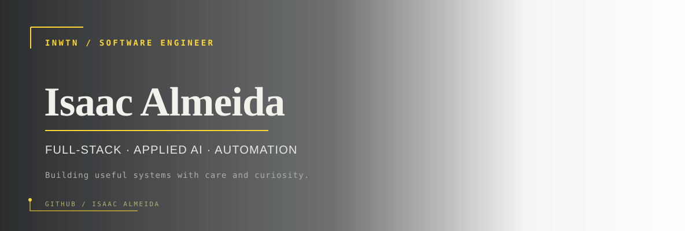
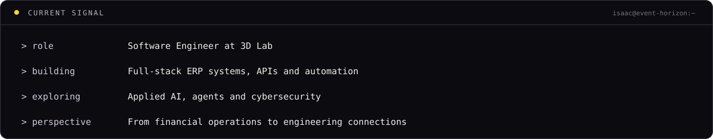
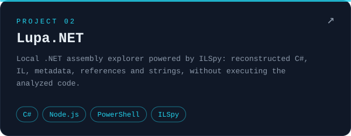

<a href="https://github.com/Inwtn">
  
</a>

<p align="center">
  <a href="https://github.com/Inwtn">
    
  </a>
</p>

<p align="center">
  <a href="https://www.linkedin.com/in/isaacalmeida-dev"></a>
  <a href="https://github.com/Inwtn"></a>
  <a href="mailto:isaacreis.dev@gmail.com"></a>
</p>


<p align="center">
  
</p>

I'm a **Software Engineer at 3D Lab**, where I architect, plan and ship full-stack features for the company's **internal ERP modules**. Day to day I work with **JavaScript, PHP, Laravel and Python**, and I've built and deployed production backend systems in **Java and Spring Boot**. My focus is on automating workflows, integrating APIs and consolidating data across systems.

I use **Generative AI, LLMs and AI agents** to boost productivity, from custom scripts and automations to refining features with prompt engineering. I'm also expanding into **cybersecurity**, driven by a genuine interest in building more secure and resilient systems.

Before moving into software, I spent **over four years in financial operations** (cash flow, bank reconciliation, accounts payable/receivable). That gave me a practical, detail-oriented approach to problem-solving and a real understanding of the business rules behind the systems I build. You can see that background in projects like the [Bank Reconciliation Engine](https://github.com/Inwtn/bank-reconciliation), and my curiosity about AI and security in [MNEME](https://github.com/Inwtn/MNEME) and [Lupa.NET](https://github.com/Inwtn/Lupa.NET).

```yaml
now:
  working_on:   internal ERP · 3D Lab
  building:     MNEME (financial research) · Bank Reconciliation Engine · StreamHub
  learning:     Cybersecurity (SIEM/IDS, incident response) · RAG · AI agents
```


<p align="center"><b><code>Backend &amp; APIs</code></b></p>
<p align="center">
  <a href="https://skillicons.dev"></a>
</p>

<p align="center"><b><code>Frontend</code></b></p>
<p align="center">
  <a href="https://skillicons.dev"></a>
</p>

<p align="center"><b><code>Data &amp; tools</code></b></p>
<p align="center">
  <a href="https://skillicons.dev"></a>
</p>

<p align="center"><b><code>AI &amp; Automation</code></b></p>
<p align="center">
  
  
  
  
  
  
</p>

<p align="center"><b><code>Cybersecurity</code></b></p>
<p align="center">
  
  
  
  
</p>

<p align="center"><sub>Also explored: ASP.NET · Kotlin · Android Studio · Jetpack Compose</sub></p>


<p align="center">
  <a href="https://github.com/Inwtn/streamhub"></a>
  <a href="https://github.com/Inwtn/Lupa.NET"></a>
  <a href="https://github.com/Inwtn/MNEME"></a>
  <a href="https://github.com/Inwtn/bank-reconciliation"></a>
</p>

<p align="center">
  <b>Live&nbsp;→</b>
  <a href="https://streamhub-inwtn.onrender.com">StreamHub</a>
</p>


```diff
+ 09/2026 → now      Software Engineer · 3D Lab
+                    full-stack internal ERP · JS · PHP/Laravel · Python · Generative AI · APIs
! 02/2025 → 06/2026  Software Developer · [COMPANY NAME]
!                    Java/Spring Boot backend · microservices · REST APIs · automation
# 10/2020 → 02/2025  Financial Analyst · Benericks Cocktail Co
# 2025 → now         Systems Analysis and Development · Newton Paiva / Wyden
```

<details>
<summary><b>Experience in detail</b></summary>
<br />

**Software Engineer · 3D Lab** · *Sep 2026 – Present*
- Architect, plan and implement full-stack features for internal ERP modules in web systems
- Build and maintain solutions with **JavaScript, PHP, Laravel, Python, databases and API integrations**
- Apply **Generative AI, LLMs, AI agents and prompt engineering** to create automations, refine features and improve productivity
- Work in agile cycles (sprints, planning, review), with feature testing, structured bug reporting and technical documentation

**Software Developer · [COMPANY NAME]** · *Feb 2025 – Jun 2026*
- Developed and deployed a **Java** backend that automated repetitive tasks, eliminating manual processes and boosting team productivity
- Automated cash flow management (up to **R$100k/month**) through automatic data feeds into smart spreadsheets
- Maintained and evolved **Java and Spring Boot** microservices and structured event-driven architectures to capture and record critical business information
- Built **REST APIs** and optimized integrations with external systems for real-time consolidation of financial data

**Financial Analyst · Benericks Cocktail Co** · *Oct 2020 – Feb 2025*
- Managed cash flow, accounts payable/receivable, bank reconciliation, management reports and the monthly financial close
- Automated financial routines with advanced spreadsheets and digital tools, which sparked my move into software development

</details>


| Certification | Issuer | Focus |
|---|---|---|
| **Google Cybersecurity** | Google (2026) | Threat identification, vulnerability management, Linux, SQL and Python for security, SIEM/IDS, incident response |
| **Started with Cybersecurity** | IBM (2026) | Core security concepts, encryption, malware and social engineering, defense best practices |
| **RAG with ChromaDB, LlamaIndex and Python** | Santander | Building LLM-integrated apps with LlamaIndex orchestration and ChromaDB as vector database |
| **Data with Python and AI** | Santander | Data analysis and visualization with Python, basic Machine Learning |
| **Web Development Fundamentals** | IBM | Semantic HTML, responsive CSS, JavaScript and DOM manipulation |

🎓 **Education:** Systems Analysis and Development · Newton Paiva / Wyden, Brazil (2025 – Present)

🌍 **Languages:** 🇧🇷 Portuguese (native) · 🇬🇧 English (B2, writing B1)


<p align="center">
  
  
</p>


<picture>
  <source media="(prefers-color-scheme: dark)" srcset="https://raw.githubusercontent.com/Inwtn/Inwtn/output/github-snake-dark.svg" />
  <source media="(prefers-color-scheme: light)" srcset="https://raw.githubusercontent.com/Inwtn/Inwtn/output/github-snake.svg" />
  
</picture>
